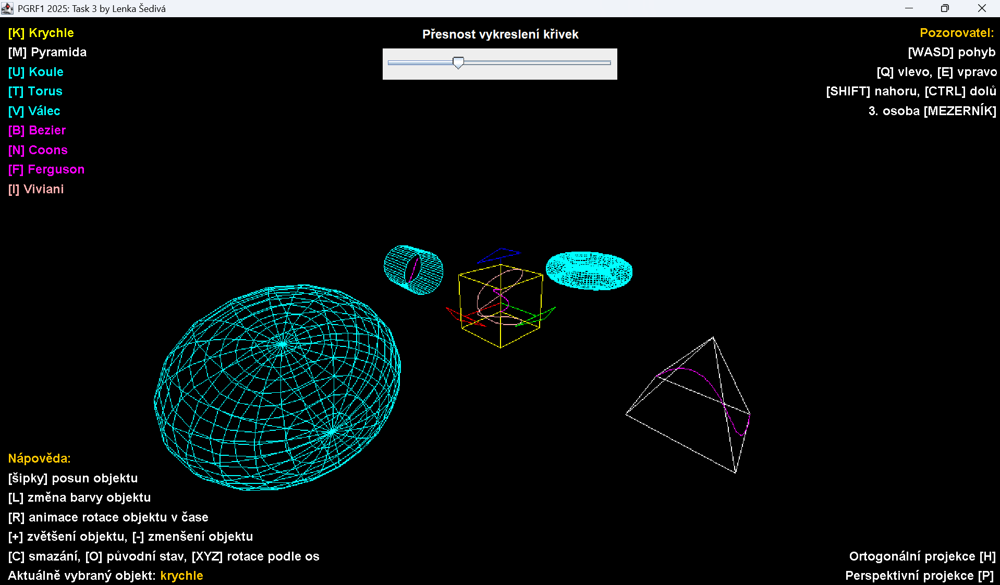

# 3D Wireframe Renderer – PGRF1 2025, Assignment 3



A Java (Swing) desktop application that renders wireframe models of 3D solids and cubic curves.
The entire graphics pipeline is written by hand: from the model, view and projection transformations, through clipping
in homogeneous coordinates and dehomogenization, to line rasterization with Bresenham's algorithm into a `BufferedImage`.
The project follows the **MVC** (Model – View – Controller) architecture.

Author: Lenka Šedivá

## Features

- **Solids:** cube, pyramid, sphere, torus, cylinder
- **Cubic curves:** Bézier, Coons, Ferguson and the parametric Viviani curve
- **X, Y, Z axes** drawn as colored arrows (red, green, blue), unaffected by the model transformation
- **Transformations of the selected object:** translation, rotation around the X/Y/Z axes, scaling around the object's center
- **Animation:** continuous rotation of the selected object (60 FPS)
- **Camera:** observer movement, mouse look, switching between first-person and third-person view
- **Projection:** perspective and orthographic
- **Object selection** by key or by mouse click (selects the object whose vertex is closest to the cursor); the selected object is highlighted in yellow
- **Color change** of an object via a `JColorChooser` dialog
- **Curve precision slider:** number of points the curves are made of (10–300)

## Controls

### Object selection

| Key | Object |
|---|---|
| `K` | cube |
| `M` | pyramid |
| `U` | sphere |
| `T` | torus |
| `V` | cylinder |
| `B` | Bézier curve |
| `N` | Coons curve |
| `F` | Ferguson curve |
| `I` | Viviani curve |
| left mouse button | object closest to the cursor |

### Working with the selected object

| Key | Action |
|---|---|
| arrow keys | translate |
| `X` / `Y` / `Z` | rotate 90° around the X / Y / Z axis |
| `+` / `-` | scale up / down |
| `R` | toggle rotation animation |
| `L` | change color |
| `O` | reset all objects to their initial state |
| `C` | clear the canvas (axes remain) |

### Camera and projection

| Key | Action |
|---|---|
| `W` `A` `S` `D` | move the observer |
| `Q` / `E` | turn the camera left / right |
| `Shift` / `Ctrl` | move up / down |
| mouse drag | rotate the camera |
| `Space` | switch between first-person and third-person view |
| `P` | perspective projection (default) |
| `H` | orthographic projection |

A help overlay listing all keys is also shown directly in the application window.

## Running

Requirements: **JDK 22 or newer** (the code uses unnamed variables `_` in lambdas).

### IntelliJ IDEA

Open the project folder, set the SDK to JDK 22+ and run the `App` class.

### Command line

```bash
javac -d out $(find src -name "*.java")
java -cp out App
```

## Project structure

```
src/
├── App.java                      entry point, creates the window and the controller
├── controller/
│   ├── Controller.java           controller interface
│   └── Controller3D.java         scene, keyboard and mouse controls, animation
├── model/
│   ├── objectdata/
│   │   ├── Line.java             2D line segment
│   │   └── mesh/
│   │       ├── Mesh.java         base solid class (vertex buffer, index buffer, model matrix)
│   │       ├── Cube, Pyramid, Sphere, Torus, Cylinder
│   │       ├── Axis, ArrowX/Y/Z  coordinate system axes
│   │       └── cubics/
│   │           ├── Curve.java    abstract curve, generates points based on precision
│   │           └── Bezier, Coons, Ferguson, VivianiCurve
│   ├── rasterdata/
│   │   ├── Raster.java           raster interface
│   │   └── RasterBI.java         raster backed by BufferedImage
│   └── rasterops/
│       ├── rasterizer/
│       │   ├── LineRasterizer.java
│       │   └── LineRasterizerBresenham.java
│       └── renderer/
│           └── Renderer3D.java   graphics pipeline
├── transforms/                   library for vectors, matrices, camera and cubics (PGRF FIM UHK)
└── view/
    ├── Window.java               main window (JFrame)
    └── Panel.java                drawing canvas, help overlay, precision slider
```

## Graphics pipeline

Each solid is stored as a list of vertices (`vertexBuffer`) and a list of index pairs forming its edges (`indexBuffer`).
For every edge, `Renderer3D`:

1. multiplies both vertices by the **MVP** matrix (model × view × projection),
2. performs **clipping** in homogeneous coordinates: `-w ≤ x ≤ w`, `-w ≤ y ≤ w`, `0 ≤ z ≤ w`,
3. performs **dehomogenization** (division by the `w` coordinate),
4. performs the **viewport transformation** (flipping the Y axis and mapping the `[-1, 1]` range to pixels),
5. draws the line using **Bresenham's algorithm**.

The view matrix is computed by the `Camera` class (azimuth, zenith, position, first/third-person mode). The projection is either
`Mat4PerspRH` (90° field of view) or `Mat4OrthoRH`.

## Libraries used

- Java Swing / AWT
- the `transforms` package by PGRF FIM UHK (matrices, vectors, camera, cubics)
